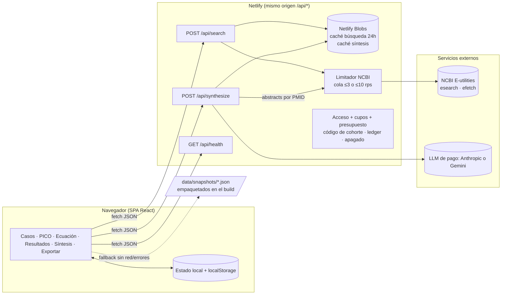
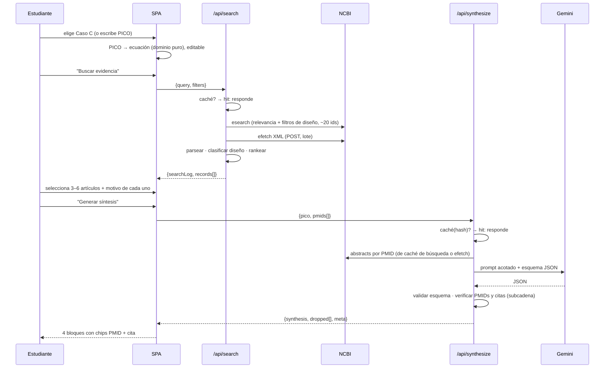

# 03 · Arquitectura

## 1. Principios

1. **El servidor es dueño de los secretos, los límites, el gasto y la verdad.** El navegador nunca habla con NCBI ni con el LLM,
   y ningún usuario aporta credenciales: el LLM lo paga el operador con topes (`07`).
2. **El LLM es el último eslabón, no el primero.** Recuperación, clasificación de diseño y ranking son código determinista;
   el LLM solo redacta/estructura sobre texto ya recuperado y su salida se valida.
3. **Todo falla con elegancia.** Cada dependencia externa (NCBI, Gemini, red) tiene un estado de error definido en la UI y un
   respaldo (caché → snapshot).
4. **Dominio puro.** Esquemas, constructor de consultas, clasificador de diseño, ranking y validador de anclaje viven en
   `src/shared/` sin React, sin `fetch`, sin Node APIs → se prueban sin red y se importan tanto en cliente como en funciones.
5. **Lo mínimo que sea correcto.** Sin base de datos, sin cuentas, sin monorepo. Un paquete, dos capas, una carpeta de datos.

## 2. Vista de componentes



### Flujo principal (caso feliz)



## 3. Stack y versiones

| Capa | Elección | Por qué |
|------|----------|---------|
| Build/Dev | **Vite 7** (o vigente estable) | Arranque inmediato, HMR, build estático para Netlify. |
| UI | **React 19 + TypeScript strict** | Estado local sencillo; ecosistema de pruebas; el usuario ya conoce el stack. |
| Estilos | **Tailwind v4** + tokens CSS propios (paleta Wiener Hound) | Rapidez + consistencia; compilado en build (no CDN). |
| Iconos | `lucide-react` | Sustituye el CDN de Lucide. |
| Estado | `useReducer` + contexto (sin Redux/Zustand) | Alcance pequeño; una sola "sesión de trabajo". |
| Validación | **Zod** | Un esquema = tipo TS + validador, compartido cliente/servidor, y base del JSON Schema para el LLM. |
| Funciones | **Netlify Functions v2** (`.mts`, `Request/Response`) | Doc oficial; 60 s síncronos; sin servidor propio. |
| Caché | **@netlify/blobs** | Persistencia gratuita de clave-valor sin montar BD. |
| XML | `fast-xml-parser` | Parseo de `efetch` en Node sin DOM. |
| Pruebas | **Vitest** + **Playwright** (+ `@axe-core/playwright`) | Unidad/contrato sin red + e2e de los 4 casos. |
| Calidad | ESLint + Prettier + `tsc --noEmit` | Compuerta mínima. |
| Gestor de paquetes | **npm** (v11 ya instalado) | Cero configuración extra. Node 22.20 disponible. |

Fijar versiones exactas en `package.json` en el momento de instalar (consultar `npm view` ese día); no hay que adivinar
números de versión ahora.

## 4. Estructura de carpetas

```
WienerProbe/
├─ docs/                          ← estos documentos
├─ data/
│  ├─ presets/                    ← casos A–D del profe (JSON, fuente de verdad del dominio)
│  │  ├─ caso-a-obesidad.json
│  │  ├─ caso-b-dm2.json
│  │  ├─ caso-c-epilepsia.json
│  │  └─ caso-d-masld.json
│  ├─ snapshots/                  ← salidas reales del pipeline, revisadas (JSON)
│  └─ course-readings.json        ← 3 lecturas del curso (PMIDs)
├─ scripts/
│  ├─ snapshot.ts                 ← corre el pipeline real y escribe data/snapshots/
│  ├─ verify-pmids.ts             ← cada PMID existe y el título coincide
│  └─ check-secrets.ts            ← busca claves en dist/
├─ netlify/functions/
│  ├─ search.mts
│  ├─ synthesize.mts
│  ├─ health.mts
│  └─ _lib/                       ← infra solo-servidor
│     ├─ ncbi.ts                  ← cliente + limitador + parser XML
│     ├─ llm/
│     │  ├─ provider.ts           ← interfaz LlmProvider
│     │  └─ gemini.ts             ← implementación
│     ├─ cache.ts                 ← Blobs con TTL
│     ├─ access.ts                ← código de cohorte + deviceId (Etapa A); verificación de sesión (Etapa B)
│     ├─ quota.ts                 ← cupos por dispositivo/usuario, presupuesto global, interruptor de apagado
│     ├─ ledger.ts                ← registro de uso (tokens, costo estimado, caché) sin texto de PICO
│     └─ log.ts                   ← logs estructurados
├─ src/
│  ├─ shared/                     ← dominio PURO (cliente + servidor)
│  │  ├─ schemas.ts               ← Zod: Pico, SearchRequest, EvidenceRecord, Synthesis…
│  │  ├─ query-builder.ts         ← PICO → ecuación booleana
│  │  ├─ design-tier.ts           ← PublicationType → jerarquía de diseño
│  │  ├─ ranking.ts
│  │  ├─ grounding.ts             ← verifica PMIDs y citas contra abstracts
│  │  ├─ prompt.ts                ← construcción del prompt (versionado)
│  │  └─ export-markdown.ts
│  ├─ app/                        ← shell, rutas/pestañas, proveedores
│  ├─ features/
│  │  ├─ cases/  pico/  search/  selection/  synthesis/  export/
│  ├─ components/                 ← UI genérica (Button, Badge, Card, Modal, Skeleton)
│  ├─ lib/                        ← api-client, storage, fallback-snapshots
│  └─ styles/                     ← tokens y capas CSS
├─ tests/
│  ├─ fixtures/                   ← XML/JSON grabados de NCBI y Gemini
│  └─ e2e/
├─ netlify.toml
├─ vite.config.ts · tsconfig.json · eslint.config.js · package.json
└─ .env.example                   ← nombres de variables, nunca valores
```

Regla de dependencias: `components` ← `features` ← `app`; `shared` no importa de nadie; `netlify/functions/_lib` puede
importar de `shared`; **`src/**` nunca importa de `netlify/**`**. Se hace cumplir con una regla de ESLint
(`no-restricted-imports`).

## 5. Contratos de API

Todos los cuerpos y respuestas se validan con Zod en ambos lados. Errores con forma uniforme:

```jsonc
{ "error": { "code": "UPSTREAM_NCBI" | "UPSTREAM_LLM" | "RATE_LIMITED" | "BAD_REQUEST"
                     | "UNAUTHORIZED" | "SCHEMA_VIOLATION" | "TIMEOUT",
             "message": "texto seguro para mostrar", "retryAfterSec": 5, "requestId": "..." } }
```

### `POST /api/search`

```jsonc
// request
{ "query": "(\"ketogenic diet\"[MeSH] OR ...) AND ...",   // ecuación final (ya editada por el usuario)
  "filters": { "designs": ["sr_ma","rct"], "yearFrom": 2015, "humans": true, "languages": ["eng","spa"] },
  "maxCandidates": 20 }
// response
{ "searchLog": { "executedAt": "2026-10-10T13:02:11Z", "database": "PubMed",
                 "query": "...", "queryTranslation": "...", "filters": {...}, "totalCount": 187 },
  "records": [ EvidenceRecord, ... ],       // ya clasificados y ordenados
  "cache": "hit" | "miss" }
```

### `POST /api/synthesize`

```jsonc
// cabeceras: x-cohort-code, x-device-id  (Etapa B: Authorization: Bearer <jwt>)
// errores nuevos: QUOTA_EXCEEDED (cupo del dispositivo/usuario), LLM_DISABLED (apagado/presupuesto) → el cliente cae a "solo evidencia"
// request  (el servidor NO acepta texto de abstracts del cliente: recibe PMIDs y los resuelve él)
{ "pico": Pico, "caseId": "C" | null, "pmids": ["32588435","42391224"], "language": "es" }
// response
{ "synthesis": Synthesis,          // ver 04 §5; ya validada y anclada
  "dropped": [ { "reason": "PMID_NOT_IN_INPUT" | "QUOTE_NOT_FOUND" | "SCHEMA", "path": "findings[2]" } ],
  "meta": { "model": "...", "promptVersion": "v1", "generatedAt": "...", "cache": "hit"|"miss",
            "inputPmids": [...], "latencyMs": 18234 } }
```

### `GET /api/health`

`{ ok, ncbi: "up"|"down"|"unknown", llm: "configured"|"missing", cacheTtlHours, version, time }` — sin llamar a Gemini
(no consume cuota); NCBI se prueba con `einfo` de bajo costo y resultado cacheado 60 s.

## 6. Errores y degradación (matriz de estados de la UI)

| Falla | Qué ve el estudiante | Mecanismo |
|-------|----------------------|-----------|
| Sin red / función caída | Banner ámbar "Sin conexión — mostrando resultado pregrabado del {fecha}" + todo funciona sobre snapshot | `lib/fallback-snapshots` si hay snapshot del caso; si es caso libre, mensaje claro + permitir copiar la ecuación y abrir PubMed |
| NCBI 429/5xx | Reintento automático con backoff (2 intentos); luego caché/snapshot | `_lib/ncbi.ts` |
| Gemini 429/5xx/timeout | Se conservan los resultados de PubMed; panel de síntesis muestra "no disponible ahora" + snapshot del caso si existe | `LlmProvider` con reintento 1× y límite de 45 s |
| Gemini devuelve JSON inválido | 1 reintento con instrucción de reparar; luego igual que arriba | Zod + reintento |
| Afirmaciones sin ancla | Se omiten y se informa "N afirmaciones descartadas por no poder verificarse" (transparencia) | `grounding.ts` |
| Evidencia insuficiente | Estado propio "Evidencia insuficiente" (no es error) | Campo `stance: "insufficient"` |
| Código de cohorte inválido/vencido | Modal para ingresar código; mientras tanto, solo modo "solo evidencia" | `access.ts` |
| Cupo agotado / presupuesto global agotado / apagado activo | Mensaje claro con cuándo se renueva; la app sigue en modo "solo evidencia" (búsqueda, ranking, registro, exportación) | `quota.ts` (HTTP 429 con `code: QUOTA_EXCEEDED` o `LLM_DISABLED`) |

## 7. Seguridad y cumplimiento

- Secretos: `LLM_PROVIDER` (`anthropic`|`gemini`), `ANTHROPIC_API_KEY` y/o `GEMINI_API_KEY`, `LLM_MODEL`, `LLM_ENABLED`,
  `LLM_BUDGET_USD_MONTH`, `NCBI_API_KEY`, `NCBI_EMAIL`, `COHORT_CODES` (o colección en Blobs) en variables de entorno de Netlify; `.env` en `.gitignore`;
  `.env.example` solo con nombres. `scripts/check-secrets.ts` falla el build si encuentra patrones de clave en `dist/`.
- Entrada del usuario: tope de longitud en todos los campos PICO; `query` ≤ 2.000 caracteres; ≤ 10 PMIDs por síntesis;
  esquema estricto (`.strict()`).
- **Inyección vía abstracts:** el texto recuperado se pasa dentro de delimitadores como *datos*, con instrucción explícita
  de ignorar órdenes contenidas en él; la salida está restringida por esquema y verificada → un abstract malicioso no puede
  añadir contenido que no sea una cita real. Defensa en profundidad, no garantía absoluta.
- Abuso: código de acceso opcional + límite simple por IP/ventana en Blobs (p. ej. 30 síntesis/10 min) + caché que absorbe
  la mayor parte del tráfico legítimo.
- Cabeceras: CSP estricta en `netlify.toml` (`default-src 'self'`; `connect-src 'self'`; fuentes locales o de Google Fonts
  con permiso explícito), `X-Content-Type-Options`, `Referrer-Policy`.
- Cumplimiento NCBI: `tool`/`email` registrados, limitador, User-Agent identificable.
- Privacidad: sin analítica de terceros; aviso de no ingresar datos identificables de pacientes.

## 8. Registro de decisiones (ADR)

| ADR | Decisión | Alternativas descartadas | Motivo |
|-----|----------|--------------------------|--------|
| 1 | SPA Vite+React, no Next.js/SvelteKit | Next en Netlify; HTML plano | Sin SSR necesario; menos piezas que fallen; pruebas/estructura que HTML plano no da. |
| 2 | BFF en Netlify Functions (mismo origen) | Llamar APIs desde el navegador | IP compartida del aula, secretos, caché, validación. Mismo origen = sin CORS ni preflight. |
| 3 | Sin base de datos | Supabase/Firebase | No hay datos de usuario; Blobs cubre caché; menos superficie de fallo. |
| 4 | Zod como fuente única de esquemas | Interfaces TS + validación manual | Se reutiliza para validar la salida del LLM y generar el JSON Schema. |
| 5 | Ranking/diseño deterministas; LLM solo sintetiza | Pedir al LLM que elija y clasifique | Reproducible, auditable, barato; evita que "invente" el nivel de evidencia. |
| 6 | Abstracts, no PDFs, en v1 | Descarga de texto completo | Muros de pago, derechos, tamaño; abstracts alcanzan para el taller. |
| 7 | Snapshots generados con el pipeline real | Matrices escritas a mano | Cero cifras inventadas; trazabilidad; regenerables. |
| 8 | Síntesis síncrona (sin streaming/background) | Streaming SSE; background function | 60 s alcanzan; menos complejidad. Streaming = mejora opcional Corte 3. |
| 9 | Proveedor LLM tras una interfaz | Llamar a Gemini en cada sitio | Cambiar de modelo/proveedor (o de API Gemini ↔ Interactions) toca un archivo. |
| 10 | npm workspaces NO; paquete único | Monorepo pnpm | Alcance chico; reduce fricción de instalación y de despliegue. |
| 11 | **LLM pagado por el operador, tier de pago, proveedor-neutral** | BYOK; tier gratuito; atarse a un proveedor | Usuarios profesionales no gestionan keys; el tier gratuito puede usar los datos para mejorar productos; cambiar de proveedor toca `llm/*.ts`. Ver `07`. |
| 12 | **Cupos y presupuesto en el servidor + tope duro en el proveedor + interruptor de apagado** | Confiar solo en el límite del proveedor | El límite del proveedor tiene retardo y no es granular por usuario; nuestra capa protege a los usuarios entre sí y permite degradar sin redeploy. |
| 13 | **Acceso por etapas:** códigos de cohorte → cuentas → pagos | Construir cuentas y pasarela desde el día 1 | Cumple la fecha del sábado sin sacrificar la ruta a producto; evita autenticación/pagos sin demanda comprobada. |
| 14 | **No persistir texto de PICO ni abstracts por usuario** | Historial en la nube desde el inicio | Minimiza riesgo de datos de pacientes y obligaciones de habeas data; el caché usa hash. |
