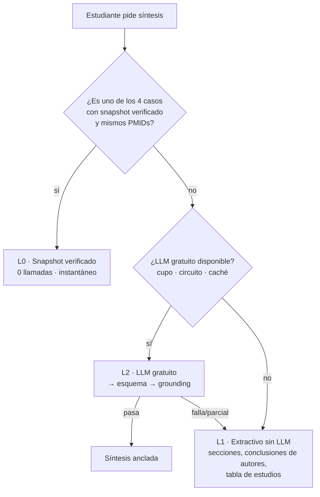

# 08 · Modo costo cero (taller del sábado y piloto sin presupuesto)

> **Restricción nueva (2026-10-09):** no hay dinero para pagar nada. El uso del sábado es solo para el taller.
> Este documento **tiene prioridad sobre `07` mientras no haya presupuesto**. `07` queda como la ruta a producto
> cuando exista quien pague o patrocine.

## 1. Conclusión corta

1. **Sí se puede, y con menos riesgo que antes**, porque el sábado casi no necesita LLM en vivo: los 4 casos del profe son
   fijos. Se generan **una sola vez, de antemano**, y la clase corre sobre esos resultados verificados.
2. Para cualquier búsqueda fuera de los 4 casos hay **dos niveles gratuitos**: (a) un resumen **extractivo sin LLM**
   (siempre disponible, costo cero, 100 % anclado a los abstracts) y (b) un LLM **gratuito** con cadena de respaldo y
   topes. Si el LLM gratuito se agota o falla, la app **no se rompe**: cae al nivel (a).
3. **Techo de gasto = 0 por construcción:** las cuentas de los proveedores gratuitos se crean **sin método de pago**. Sin
   tarjeta asociada no existe forma de que generen un cobro.
4. **Costo de la compensación:** los tiers gratuitos *pueden usar lo que envías para mejorar sus productos y mostrarlo a
   revisores humanos*. Eso es aceptable **solo** porque en el taller se usan viñetas ficticias del profe + abstracts
   públicos, y la app bloquea datos de pacientes. **No es aceptable** para que profesionales analicen pacientes reales
   (ahí se necesita tier de pago o solo nivel (a)). Ver §6.

## 2. Las tres capas de "síntesis" (de más barata a más rica)

| Capa | Cómo funciona | Costo | Calidad | Disponibilidad |
|------|---------------|-------|---------|----------------|
| **L0 · Snapshot verificado** | Síntesis estructurada (esquema de `04` §5) generada de antemano para los casos A–D, validada por `grounding.ts` y revisada por una persona. | $0 | Alta (revisada) | 100 % (estática, sin red) |
| **L1 · Extractivo (sin LLM)** | Código determinista: por artículo, muestra diseño, año, n (si aparece), y las secciones *Objectives / Main results / Authors' conclusions* **textuales**; frases con cifras y términos de desenlace resaltadas; tabla comparativa de estudios; cuenta de revisiones vs ECA. Cada pieza es una cita literal por construcción. | $0 | Media: no redacta ni compara, pero no puede alucinar | 100 % (solo necesita PubMed, o el caché) |
| **L2 · LLM gratuito** | Cadena de proveedores gratuitos con router, cupos y *circuit breaker* (§4). Salida con esquema + grounding; lo que no verifica se descarta. | $0 (con topes) | Media-alta si el modelo cumple el esquema | Variable (límites) |

> Con L0 + L1, **la clase del sábado no depende de ningún proveedor externo de IA.** L2 es un extra.

## 3. Opciones gratuitas investigadas (estado de verificación incluido)

`✔` = confirmado en documentación oficial hoy · `⚠` = solo fuentes de terceros o información incompleta; **no confiar hasta probarlo con una cuenta real**.

| Opción | Qué ofrece gratis | Condiciones / riesgos | Veredicto |
|--------|------------------|------------------------|-----------|
| **Gemini API · tier gratuito** (Google AI Studio) | ✔ Existe tier gratuito para 3.8/3.6 Flash y 3.5/3.1 Flash-Lite (precio $0). ✔ Límites exactos solo visibles en `aistudio.google.com/rate-limit`. ⚠ Terceros hablan de ~20 solicitudes/día en los Flash más nuevos y ~500/día en Flash-Lite, y de recortes sin aviso. | ✔ Contenido usado para mejorar productos; puede leerlo un revisor humano; "no enviar información sensible". Límites por proyecto, no por key. Sin tarjeta. | **Primario de L2** para el taller (viñetas ficticias). Crear la key en AI Studio **sin vincular facturación**. |
| **OpenRouter · modelos `:free`** | ✔ 20 solicitudes/min y **50/día** si has comprado < 10 créditos (1.000/día con ≥ 10 créditos, que es pago). | ✔ La lista de modelos gratuitos cambia; soporte de JSON/esquema varía por modelo (`⚠`). Un saldo negativo da 402 aun en gratis → **no cargar créditos**. Los prompts pasan por terceros. | **Respaldo 1 de L2** (pocas solicitudes, pero suma cupo). |
| **Cloudflare Workers AI** | ✔ 10.000 *neurons*/día en el plan gratuito, reinicio 00:00 UTC. | `⚠` Cuántas síntesis caben en 10.000 neurons depende del modelo (no verificado); `⚠` soporte de JSON mode por modelo. Corre en la misma infraestructura que ya usaríamos para el sitio. | **Respaldo 2 de L2** si la prueba muestra que cumple el esquema. |
| **Qwen (Alibaba Cloud Model Studio)** | `⚠` Cuentas nuevas, región Internacional (Singapur): ~1 M tokens de entrada + 1 M de salida gratis durante 90 días. | `⚠` Solo Singapur (no la región de EE. UU.); el cupo gratuito de Qwen Code por OAuth terminó el 15-abr-2026; otro sitio dice 70 M tokens pero se contradice. Datos salen a Alibaba (Singapur). Registro más pesado. | Posible respaldo, **no prioritario**: más fricción y menos confianza en los datos. |
| **Mistral · tier "Experiment"** | `⚠` Acceso limitado con verificación por SMS, sin tarjeta; los límites ya no se publican y una prueba reciente dice que solo algunos modelos pequeños responden en la key gratuita. | Datos pueden usarse para entrenar en el tier gratuito (`⚠` verificar). | No prioritario. |
| **Groq** | Hay plan gratuito (`⚠` la página consultada no mostró sus límites; se ven en la consola de la cuenta). Corre modelos abiertos (gpt-oss, Qwen). | `⚠` Política de datos no verificada aquí. | Candidato a probar si falta cupo. |
| **DeepSeek (API)** | ✘ No hay API gratuita; es de pago y barata (~US$ 0,15 / 0,60 por M tokens en V4.1 Flash fuera de hora pico, el doble en hora pico, según terceros). | Servidores en China; no apto para contexto de salud sin consentimiento explícito. | **Descartado.** |
| **Cerebras** | ✘ Ahora es crédito de prueba (US$ 5, 30 días) y exige método de pago verificado. | Contradice la regla de "sin tarjeta". | **Descartado.** |
| **Claude Haiku 5.5** | ✘ No es gratis (US$ 0,10 / 0,50 por M tokens). Como referencia, US$ 5 de saldo alcanzarían para ≈ 1.500–3.000 síntesis. | Solo si algún día hay un presupuesto mínimo. | Fuera del taller; opción futura barata (`07`). |
| **Modelo en el navegador** (WebLLM / Transformers.js) | $0 y privado: corre en el equipo del usuario. | Descarga de 1–2 GB, requiere WebGPU, mala calidad en JSON y citas literales, lento en celulares. | **Descartado** para el taller. |

## 4. Router de proveedores gratuitos (diseño)

- Interfaz `LlmProvider` ya prevista. Se añade un **`FreeTierRouter`** que prueba proveedores en orden configurable
  (`LLM_CHAIN=gemini,openrouter,cloudflare`).
- **Circuit breaker por proveedor:** al recibir 429/402/403/5xx se marca "agotado hasta la hora de reinicio" (p. ej.
  medianoche Pacífico para Gemini, 00:00 UTC para Cloudflare, o 15 min por defecto) y no se vuelve a llamar hasta entonces.
- **Cupo propio por dispositivo y por cohorte** (contadores, no dólares): p. ej. 3 síntesis/día/dispositivo en L2, ilimitado en L0 y L1.
- **Caché** por hash(PICO + PMIDs + versión de prompt) → un resultado vale para toda la clase.
- **Grounding obligatorio** sin excepciones: un modelo gratuito más débil produce más ítems descartados, no más errores visibles.
- **Interruptor** `LLM_ENABLED=false` → todo en L0/L1 sin redeploy.
- **Pruebas de aceptación por proveedor** (script `npm run provider:probe`): 5 abstracts reales → ¿devuelve JSON válido? ¿cuántos
  ítems pasan grounding? ¿latencia? Un proveedor entra a la cadena **solo si pasa** (umbral inicial: ≥ 70 % de ítems anclados).

## 5. Quién genera los snapshots L0 sin gastar dinero

El valor de L0 depende de que el contenido sea correcto. Propuesta sin costo extra:

1. El pipeline real trae de PubMed los abstracts de cada caso (gratis).
2. **Yo (Claude, en esta sesión de desarrollo) redacto la síntesis en el formato de `04` §5 leyendo los abstracts reales**, y cada ítem
   debe llevar su PMID y su cita literal.
3. El validador `grounding.ts` comprueba mecánicamente PMID, cita literal y cifras; lo que no pasa se corrige o se elimina.
4. **Revisión humana** (tú o el profe) antes del sábado; se anota `reviewedBy`.
5. Metadatos honestos en el archivo y en la UI: `source: "assistant-authored"`, `model: "claude-sonnet-5-5 (sesión de desarrollo)"`,
   `generatedAt`, `reviewedBy`. Texto en pantalla: *"Síntesis elaborada con asistencia de IA y verificada automáticamente
   contra los abstracts de PubMed"*.
6. Más adelante, si hay presupuesto, `npm run snapshot` puede regenerarlos con el pipeline automático; el formato es el mismo.

Esto reemplaza la idea de `04` §7 de generar los snapshots llamando a un LLM de pago; el resto de `04` §7 no cambia.

## 6. Qué cambia con "gratis" en privacidad y cumplimiento

| Aspecto | Taller con viñetas ficticias (modo costo cero) | Uso profesional con pacientes reales |
|---------|-----------------------------------------------|---------------------------------------|
| Tier gratuito de Gemini/OpenRouter/etc. | **Aceptable**: datos = viñetas del profe + abstracts públicos. | **No aceptable**: pueden usarse para mejorar productos y revisarse por humanos. |
| Qué hace la app | Banner fijo "Taller: no ingreses datos de pacientes reales"; detector de patrones (documento, teléfono, correo, fecha de nacimiento) que **bloquea** el envío al LLM. | Requiere tier de pago o quedarse en L0/L1; ver `07`. |
| Términos de proveedor | Gemini prohíbe el uso en práctica clínica/consejo médico: se cumple porque es ejercicio educativo y la salida es resumen de literatura. | Posicionar siempre como herramienta de literatura; revisión humana cualificada. |
| Datos personales del usuario | Etapa A: ninguno (sin cuentas). | Habeas data aplica en cuanto haya cuentas (`07` §6). |

**Regla de producto:** la app muestra en el pie y en la exportación qué capa produjo cada bloque (L0 verificado / L1 extractivo /
L2 IA gratuita) para que nadie confunda un resumen automático con una revisión humana.

## 7. Cambios en el plan técnico (respecto a `05`)

| Cambio | Detalle |
|--------|---------|
| **Fase 0.5 reformulada** | Sin cuentas de pago. Tareas: (a) crear la key gratuita de AI Studio (la crea el usuario; sin tarjeta; sin vincular facturación) y probar el esquema; (b) opcional: cuentas gratuitas de OpenRouter y Cloudflare para la cadena de respaldo; (c) `provider:probe` para cada una; (d) leer en AI Studio los límites reales. **0.5b (tope de gasto en proveedor) se cancela:** no hay facturación. |
| **Nueva tarea 1.8** | `extractive.ts` (dominio puro): resumen L1 determinista + tests (cada fragmento mostrado es subcadena del abstract). |
| **Nueva tarea 2.4b** | `FreeTierRouter` + circuit breaker + `provider:probe` + tests con proveedores simulados (429, JSON inválido, timeout). |
| **2B.2 cambia** | `quota.ts` cuenta **solicitudes por proveedor y por dispositivo**, no dólares. `LLM_BUDGET_USD_MONTH` desaparece del modo gratuito. |
| **Fase 4 (snapshots)** | Se hacen en la sesión de desarrollo por asistencia (§5), no con `npm run snapshot` de pago. |
| **Alcance de acceso** | Etapa A (códigos de cohorte) sin cambios. Etapas B y C quedan bloqueadas hasta que exista presupuesto o patrocinador. |
| **Netlify Free** | 300 créditos/mes; cada **deploy de producción cuesta 15** → ≈ 20 despliegues al mes. Planificar los despliegues (no desplegar por cada cambio menor) y probar con `netlify dev` en local. (`⚠` confirmar si los *deploy previews* consumen créditos.) |

## 8. Capacidad esperada del taller (orden de magnitud)

- 4 equipos × 1 caso fijo cada uno → **0 llamadas a LLM** (L0).
- Si cada estudiante prueba un PICO propio: ~30 × 2 = 60 síntesis; con caché por PICO idéntico y hasta 3/día/dispositivo →
  decenas de llamadas reales, dentro de lo que sostiene Gemini gratuito + respaldos; el excedente cae a L1.
- Pico crítico: todos presionando "Generar" a la vez → el caché y el cupo por dispositivo lo absorben; L1 es instantáneo.

## 9. Riesgos específicos del modo gratuito

| Riesgo | Mitigación |
|--------|------------|
| Google recorta o cambia el cupo gratuito sin aviso | L0 y L1 no dependen de él; `provider:probe` el día anterior y el mismo día |
| El modelo gratuito no cumple el esquema o cita mal | Grounding descarta; umbral de aceptación; cae a L1 |
| Se filtra el link y consumen el cupo | Código de cohorte + cupo por dispositivo + circuit breaker; L0/L1 siguen |
| Alguien pega datos de un paciente real | Banner + detector que bloquea el envío al LLM |
| Cuenta gratuita sin verificar / suspendida | Cadena con ≥ 2 proveedores; L1 siempre disponible |
| Percepción de "resultados inventados" | Etiqueta de capa en cada bloque + citas literales + enlaces a PubMed |

## 10. Decisiones que necesito de ti

1. **¿Creas la key gratuita de Google AI Studio?** (2 min, solo cuenta Google, **sin tarjeta y sin activar facturación**.) Yo no puedo
   crearla ni verla; la pegas tú en las variables de Netlify. Si prefieres no usar ningún LLM el sábado, basta con L0 + L1.
2. **¿Aceptas la condición del §6?** En el taller solo viñetas ficticias y abstracts públicos; nada de pacientes reales.
3. **¿Quién revisa los snapshots L0** antes de la clase (tú, el profe)? Sin revisión se publican con la etiqueta "pendiente de revisión".
4. **¿Dejamos OpenRouter/Cloudflare como respaldos opcionales** o nos quedamos solo con Gemini gratuito + L1 para simplificar?
   Recomendado para el sábado: **solo Gemini gratuito + L0 + L1**; los demás, después.
